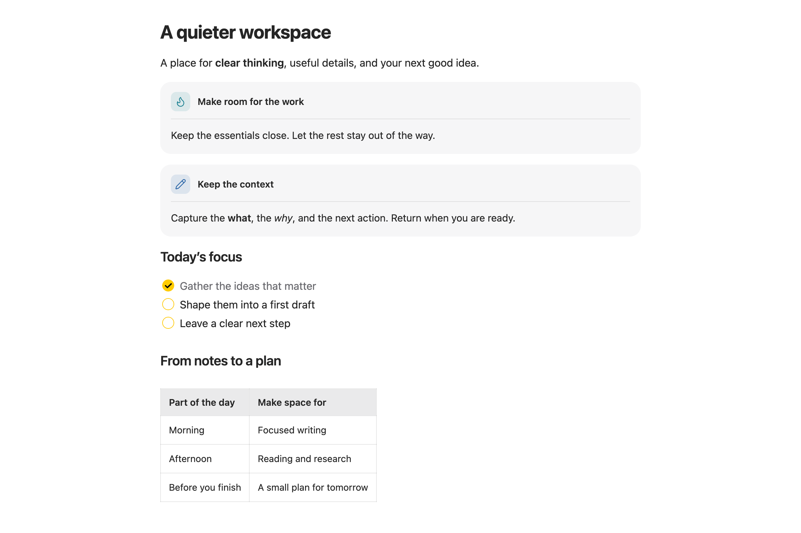
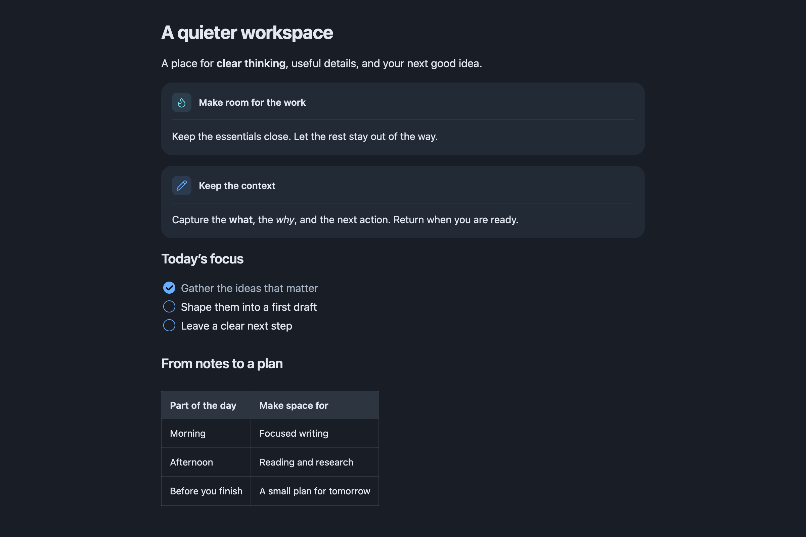
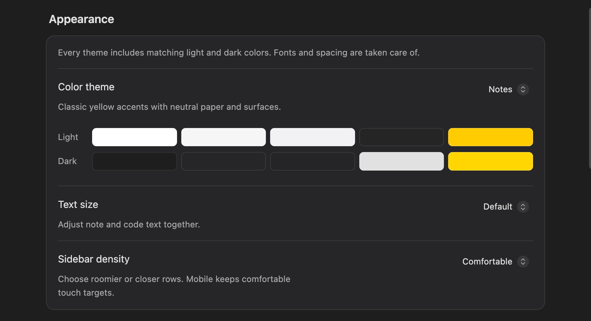
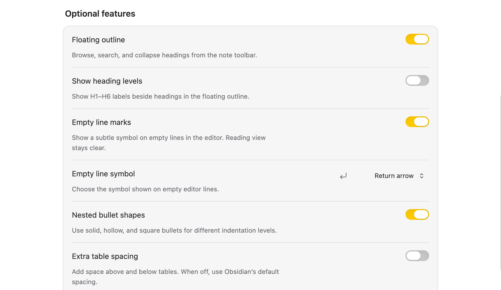
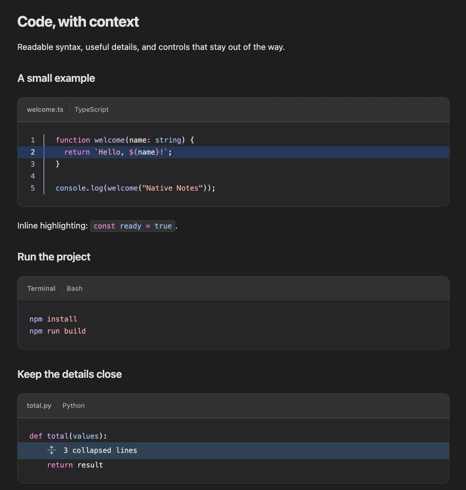
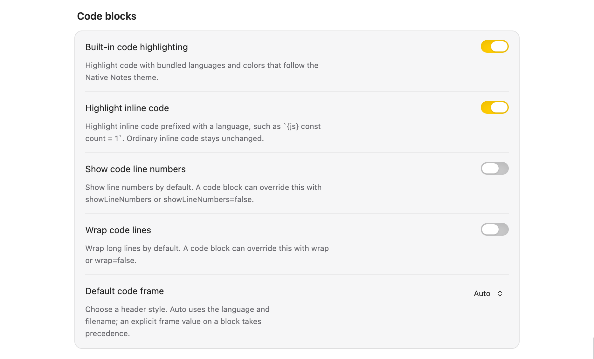
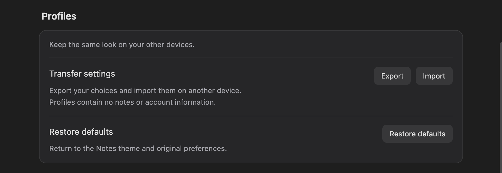

# Native Notes

Apple-inspired design for Obsidian, with useful editing tools and portable preferences.

**[Install in Obsidian](https://community.obsidian.md/plugins/native-notes)** · [Installation guide](docs/INSTALL.md) · [Latest release](https://github.com/PratiyushT/native-notes/releases/latest)

[Quick start](#quick-start) · [Appearance](#choose-your-appearance) · [Optional features](#make-the-tools-your-own) · [Code highlighting](#highlight-code-and-edit-headers) · [Profiles](#take-your-preferences-with-you)

Requires **Obsidian 1.13.0 or later**. Available for macOS, Windows, Linux, iPhone, and iPad.

## Quick start

1. In Obsidian, open **Settings → Community plugins → Browse**, search for **Native Notes**, then select **Install** and **Enable**. You can also open its [Community Plugins page](https://community.obsidian.md/plugins/native-notes).
2. Open **Settings → Native Notes**. Choose a color theme, text size, and sidebar density. Start with Obsidian's **Default** theme for the most predictable appearance.
3. Open a note and try the outline button in its toolbar. Configure any optional features below.

Native Notes includes its own styles and SVG icons and uses local system fonts. Disable it under **Community plugins** to return to your underlying theme while retaining its preferences.

*Notes preset · Light mode. Native Notes 2.4.3 on macOS, with grouped callouts and public example content.*

## Choose your appearance

Five presets coordinate the editor, sidebars, navigation, properties, lists, tables, callouts, code blocks, math, and Mermaid diagrams. Each has light and dark colors; **Obsidian → Appearance** controls which mode is active. System fonts and consistent spacing complete the design.

*The same note in Native Notes 2.4.3 with the Ocean preset in dark mode.*

Callouts use rounded neutral cards, small colored icon tiles, and a subtle divider below the title. Standard callout types and custom colors keep their meaning. Add `> [!note]`, `> [!tip]`, or another callout type to a blockquote; add `+` or `-` after the type to make it expandable or initially collapsed. The same styling works in Live Preview and Reading view.

The settings page groups everything under **Appearance**, **Optional features**, **Code blocks**, and **Profiles**. Appearance changes apply immediately.

| Appearance setting | Default | What it changes |
| --- | --- | --- |
| **Color theme** | Notes | Choose Notes, Ocean, Forest, Rose, or Graphite. The palette preview shows both light and dark colors. |
| **Text size** | Default | Small, Default, or Large adjusts note and code text together. |
| **Sidebar density** | Comfortable | Comfortable or Compact changes row spacing; mobile retains comfortable touch targets. |

## Make the tools your own

These are the defaults for a new installation. Settings that depend on another feature are described below.

| Optional setting | Default | What it does |
| --- | --- | --- |
| **Floating outline** | On | Opens a searchable, collapsible heading panel from the note toolbar. |
| **Show heading levels** | Off | Adds H1–H6 labels when the floating outline is enabled. |
| **Empty line marks** | On | Marks actual empty editor lines; Reading view and print remain clear. |
| **Empty line symbol** | Return arrow | Choose Return arrow, Paragraph mark, Dot, Circle, Dash, or Line break. The choice is retained while marks are off. |
| **Nested bullet shapes** | On | Uses solid, hollow, and square bullets at different indentation levels. |
| **Extra table spacing** | Off | Adds 16px above and 24px below tables. Off uses Obsidian's normal margins. |
| **Image alignment** | On | Adds Left, Center, and Right controls for supported images and Mermaid diagrams. |
| **Folder and note icons** | On | Distinguishes notes from folders; expanded folders use an open-folder icon. |
| **Show language beside filename** | On | Adds the language beside named rendered code blocks. |
| **Editable code headers** | On | Lets you edit filenames and languages in rendered code headers in Live Preview. |
| **Translucent navigation** | On | Softens desktop popovers. Mac sidebars also require Obsidian's **Translucent window** preference; Windows, Linux, and mobile keep solid sidebars. |
| **Hide left ribbon** | Off | Hides the desktop ribbon. Its commands remain available in the command palette. |

Empty-line marks follow the Markdown source. Empty-looking caret space around rendered tables stays usable and is not marked as a blank line.

### Navigate with the floating outline

Click the outline button in the note toolbar, or run **Native Notes: Toggle floating outline** from the command palette. Click a heading to jump to it in Live Preview or Reading view. Collapse nested sections to focus on a part of the note; the current section is highlighted as you move through it.

Search appears when a note has five or more headings. Selecting a result clears the search and leaves the panel open. Press **Escape**, click outside, or use the toolbar button again to close it.

### Align images and diagrams

In Live Preview, open **Alignment** beside a standalone image or Mermaid diagram and choose **Left**, **Center**, or **Right**. Desktop controls appear on hover; touch controls do not require hover. Reading view displays the saved position without editing controls.

Alignment keeps the block's dimensions and contents intact and supports normal editor undo. A full-width block has no spare horizontal space to move. The choice travels with the note as a hidden comment such as `<!-- native-notes:align=center -->`; Source mode exposes it. Turning the feature off retains that choice.

Supported blocks are standalone wiki images, standalone Markdown images, and root-level Mermaid fences. Inline images, reference-style images, and media inside lists, tables, or callouts are left unchanged.

### Highlight code and edit headers

Native Notes includes code highlighting, filename and terminal frames, Copy controls, line numbers, line/text markers, and collapsible code sections. Languages are bundled, and code colors follow your Native Notes preset and Obsidian's light/dark mode.

*Native Notes 2.4 on macOS · Built-in code highlighting with public example content.*

*Native Notes 2.4.4 on macOS · Built-in code preferences.*

| Code blocks setting | Default | What it does |
| --- | --- | --- |
| **Built-in code highlighting** | On | Renders supported code using the bundled highlighter. |
| **Highlight inline code** | On | Highlights inline code with a language prefix, such as `` `{js} const count = 1` ``. |
| **Show code line numbers** | Off | Adds line numbers to rendered code blocks by default. |
| **Wrap code lines** | Off | Wraps long lines in rendered code blocks by default. |
| **Default code frame** | Auto | Chooses Auto, Code, Terminal, or None. Explicit fence metadata takes precedence. |

Turning built-in highlighting off retains these preferences. In Live Preview, click a rendered filename or language to edit it. Keyboard users can focus the header and press **Enter**, **Space**, or **F2**. Press **Enter** or click away to save; press **Escape** to cancel. Each edit changes only the corresponding code-fence value, preserves the viewport, and supports normal undo. Language-only blocks stay language-only. Reading-view headers remain static, and `frame="none"` hides the header.

See the [code highlighting guide](docs/CODE-HIGHLIGHTING.md) for examples, per-block options, inline syntax, and supported languages.

## Take your preferences with you

Under **Profiles → Transfer settings**, choose **Export → Copy**. On the receiving device or vault, install Native Notes, choose **Import**, paste the profile, and select **Import** to apply it. **Save file** and **Choose file** provide the same workflow through a JSON file.

Profiles contain only Native Notes appearance, code highlighting, and editor preferences. They exclude notes and Obsidian's own settings. Import replaces the current Native Notes preferences. **Restore defaults** returns to the Notes preset and the defaults listed above after confirmation; export first if you want to keep your choices.

Older version 1 profiles are accepted and converted to the closest preset and text size. For installation on another device or synchronization of plugin settings, see the [installation guide](docs/INSTALL.md). JSON-file downloads have not been verified on physical iPhone or iPad hardware; copying profile text avoids relying on a download.

Upgrading from 2.2 or earlier? Version 2.3 removes cloud-folder setup and recovery tools. Existing saved history is left untouched, but this version cannot capture, browse, or restore it. See [preserving earlier recovery data](docs/SYNC.md). Your vault's existing sync service continues independently.

## Platform availability

| Platform | Appearance and controls |
| --- | --- |
| macOS | System fonts, native window controls, and optional translucent sidebars through Obsidian's setting. |
| Windows and Linux | Local system fonts, standard window controls, and solid sidebars. |
| iPhone and iPad | Solid surfaces and comfortable controls that do not require hover. |

Built-in code highlighting is included on every supported platform. Preferences can travel through a settings profile or your existing Obsidian settings synchronization.

Native Windows/Linux in-app validation and physical iPhone/iPad validation remain outstanding. Automated platform and responsive-layout fixtures do not replace device testing.

## Privacy and limits

- **No telemetry or plugin network requests.** Fonts and icons are local. Preferences are stored in the vault's plugin configuration.
- **Copy is an intentional clipboard write.** **Profiles → Export → Copy** writes the displayed profile; a code block's **Copy** button writes its code. Both require an explicit click. Native Notes never reads or monitors the clipboard. The Community Plugins directory may report this as a clipboard capability advisory. If access fails, select the text and use your device's copy command.
- **Edits stay in your notes.** Appearance alone does not rewrite Markdown. Code-header edits change the selected fence value; alignment saves a hidden comment. Disabling the plugin does not undo these saved edits.

## Source and distribution

Native Notes development source is maintained in a private repository. The public repository contains the installable JavaScript, styles, version metadata, user guides, and license notices. Obsidian installations and updates continue to use the same public release address. Distributed JavaScript remains inspectable; previously published source and its existing license grants are unaffected.

## Help

[Installation and updates](docs/INSTALL.md) · [Report an issue](https://github.com/PratiyushT/native-notes/issues)

Released under the [MIT license](LICENSE). Native Notes is an independent project and is not affiliated with Apple, Microsoft, or Obsidian.
