# Native Notes

Apple-inspired design for Obsidian, with useful editing tools and portable preferences.

**[Install in Obsidian](https://community.obsidian.md/plugins/native-notes)** · [Installation guide](docs/INSTALL.md) · [Latest release](https://github.com/PratiyushT/native-notes/releases/latest)

[Quick start](#quick-start) · [Appearance](#choose-your-appearance) · [Optional features](#make-the-tools-your-own) · [Insert menu](#insert-with-the-slash-menu) · [Code highlighting](#highlight-code-and-edit-headers) · [Flowcharts](#build-flowcharts-visually) · [Math](#compose-and-render-equations) · [Profiles](#take-your-preferences-with-you)

Requires **Obsidian 1.13.0 or later**. Available for macOS, Windows, Linux, iPhone, and iPad.

## Quick start

1. In Obsidian, open **Settings → Community plugins → Browse**, search for **Native Notes**, then select **Install** and **Enable**. You can also open its [Community Plugins page](https://community.obsidian.md/plugins/native-notes).
2. Open **Settings → Native Notes**. Choose a color theme, text size, and sidebar density. Start with Obsidian's **Default** theme for the most predictable appearance.
3. Open a note and try the outline button in its toolbar. Configure any optional features below.

Native Notes includes its own styles and SVG icons and uses local system fonts. Disable it under **Community plugins** to return to your underlying theme while retaining its preferences.

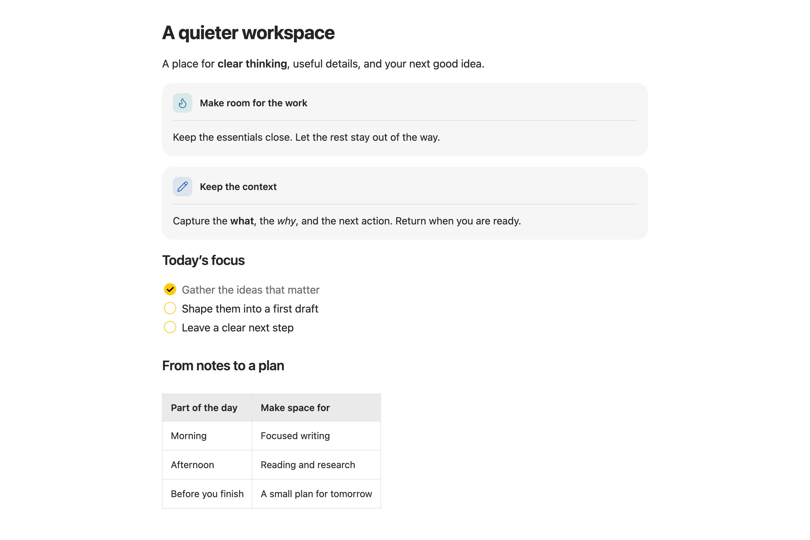

*Notes preset · Light mode. Native Notes 2.4.3 on macOS, with grouped callouts and public example content.*

## Choose your appearance

Five presets coordinate the editor, sidebars, navigation, properties, lists, tables, callouts, code blocks, math, and Mermaid diagrams. Each has light and dark colors; **Obsidian → Appearance** controls which mode is active. System fonts and consistent spacing complete the design.

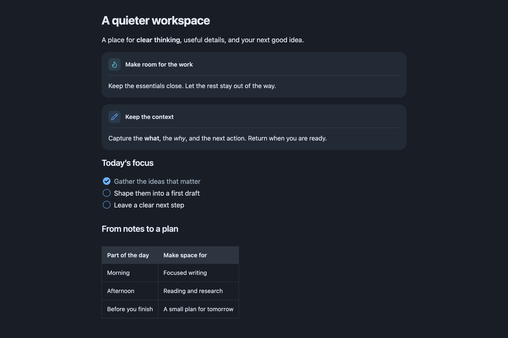

*The same note in Native Notes 2.4.3 with the Ocean preset in dark mode.*

Callouts use rounded neutral cards, small colored icon tiles, and a subtle divider below the title. Standard callout types and custom colors keep their meaning. Add `> [!note]`, `> [!tip]`, or another callout type to a blockquote; add `+` or `-` after the type to make it expandable or initially collapsed. The same styling works in Live Preview and Reading view.

The settings page groups everything under **Appearance**, **Optional features**, **Code blocks**, **Math**, and **Profiles**. Appearance changes apply immediately.

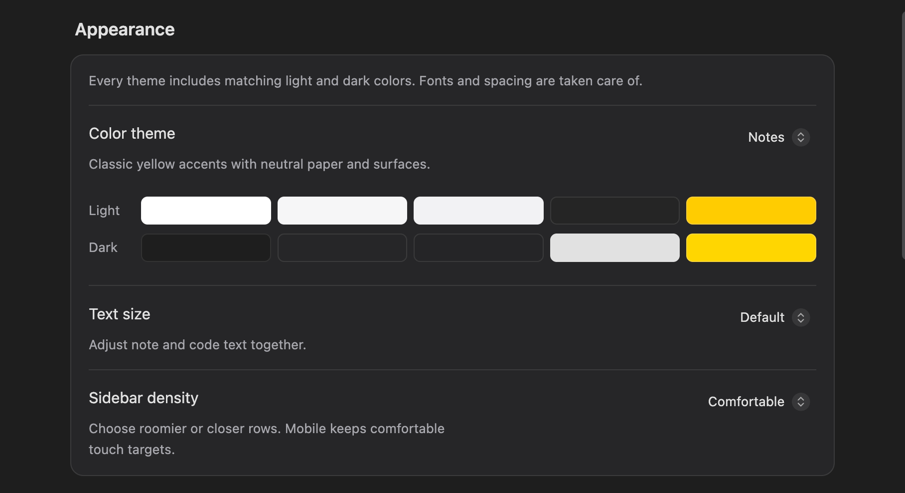

| Appearance setting | Default | What it changes |
| --- | --- | --- |
| **Color theme** | Notes | Choose Notes, Ocean, Forest, Rose, or Graphite. The palette preview shows both light and dark colors. |
| **Text size** | Default | Small, Default, or Large adjusts note and code text together. |
| **Sidebar density** | Comfortable | Comfortable or Compact changes row spacing; mobile retains comfortable touch targets. |

## Make the tools your own

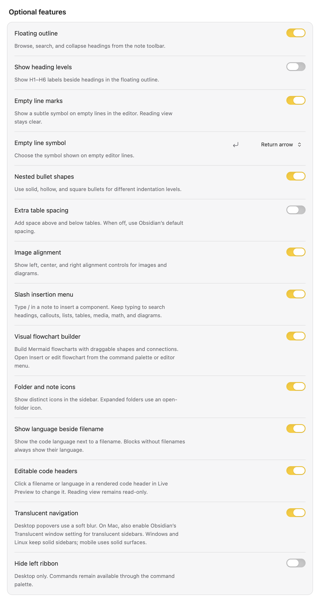

These are the defaults for a new installation. Settings that depend on another feature are described below.

| Optional setting | Default | What it does |
| --- | --- | --- |
| **Floating outline** | On | Opens a searchable, collapsible heading panel from the note toolbar. |
| **Show heading levels** | Off | Adds H1–H6 labels when the floating outline is enabled. |
| **Empty line marks** | On | Marks actual empty editor lines; Reading view and print remain clear. |
| **Empty line symbol** | Return arrow | Choose Return arrow, Paragraph mark, Dot, Circle, Dash, or Line break. The choice is retained while marks are off. |
| **Nested bullet shapes** | On | Uses solid, hollow, and square bullets at different indentation levels. |
| **Extra table spacing** | Off | Adds 16px above and 24px below tables. Off uses Obsidian's normal margins. |
| **Image alignment** | On | Adds Left, Center, and Right controls for supported images and Mermaid diagrams. |
| **Slash insertion menu** | On | Type `/` to browse and search components without leaving the editor. |
| **Visual flowchart builder** | On | Builds and edits Mermaid flowcharts using draggable shapes and connections. |
| **Folder and note icons** | On | Distinguishes notes from folders; expanded folders use an open-folder icon. |
| **Show language beside filename** | On | Adds the language beside named rendered code blocks. |
| **Editable code headers** | On | Lets you edit filenames and languages in rendered code headers in Live Preview. |
| **Translucent navigation** | On | Softens desktop popovers. Mac sidebars also require Obsidian's **Translucent window** preference; Windows, Linux, and mobile keep solid sidebars. |
| **Hide left ribbon** | Off | Hides the desktop ribbon. Its commands remain available in the command palette. |

Empty-line marks follow the Markdown source. Empty-looking caret space around rendered tables stays usable and is not marked as a blank line.

### Navigate with the floating outline

Click the outline button in the note toolbar, or run **Native Notes: Toggle floating outline** from the command palette. Click a heading to jump to it in Live Preview or Reading view. Collapse nested sections to focus on a part of the note; the current section is highlighted as you move through it.

Search appears when a note has five or more headings. Selecting a result clears the search and leaves the panel open. Press **Escape**, click outside, or use the toolbar button again to close it.

### Align images and diagrams

In Live Preview, open **Alignment** beside a standalone image or Mermaid diagram and choose **Left**, **Center**, or **Right**. Desktop controls appear on hover; touch controls do not require hover. Reading view displays the saved position without editing controls.

Alignment keeps the block's dimensions and contents intact and supports normal editor undo. A full-width block has no spare horizontal space to move. The choice travels with the note as hidden Markdown metadata. While Image alignment is enabled, this stays hidden while editing in Live Preview and Source mode, including when the caret or a selection reaches its line. Turning the feature off retains the saved choice.

Supported blocks are standalone wiki images, standalone Markdown images, and root-level Mermaid fences. Inline images, reference-style images, and media inside lists, tables, or callouts are left unchanged.

### Insert with the slash menu

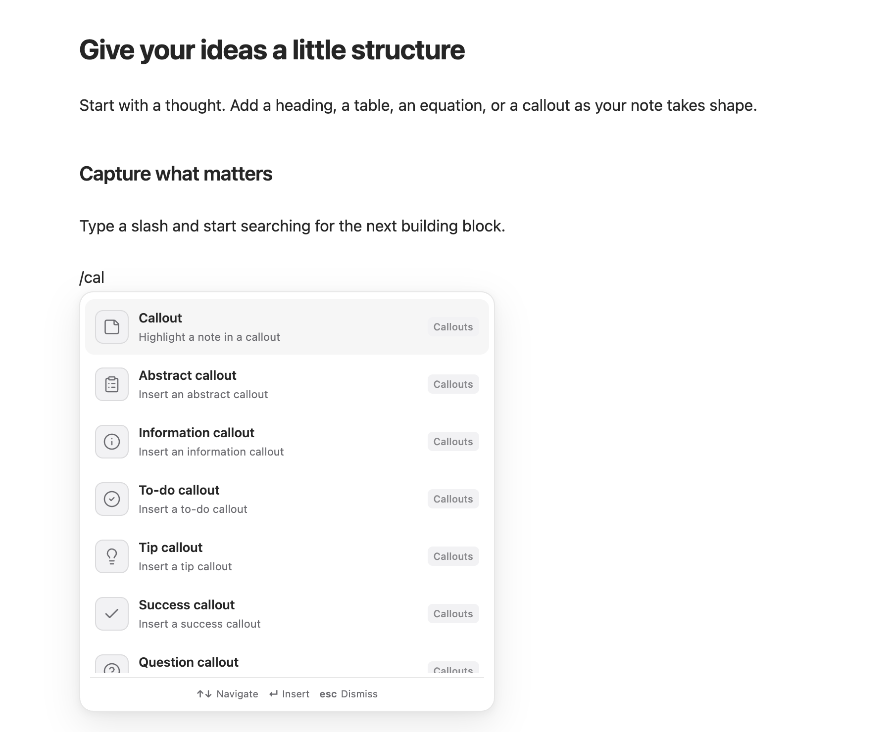

Type `/` in a note to open a compact insert menu at the cursor. Keep typing to filter its components: `/cal` finds callouts, and fuzzy search also accepts incomplete names. Use the arrow keys to move through results and **Enter** to insert, or click or tap a result. **Escape** dismisses the menu and leaves what you typed in the note.

Choose from common Markdown blocks, headings, lists, callouts, tables, links, images, code, math, and diagrams. The flowchart and equation entries open Native Notes' visual editors. These editors keep a draft until you choose to insert; cancelling leaves your note unchanged. Entries that require an optional editor are available while that editor is enabled.

Selecting a component replaces the `/` query at its original location and positions the cursor for the next edit. It preserves the surrounding note and supports normal undo. Code, existing links, and other protected source contexts do not open the menu. The menu works locally through Obsidian's native editor suggestions, with no network requests or separate window.

The menu follows the app's light or dark appearance and supports touch selection. Turn **Settings → Native Notes → Optional features → Slash insertion menu** off to remove it without changing any note content.

### Highlight code and edit headers

Native Notes includes code highlighting, filename and terminal frames, Copy controls, line numbers, line/text markers, and collapsible code sections. Languages are bundled, and code colors follow your Native Notes preset and Obsidian's light/dark mode.

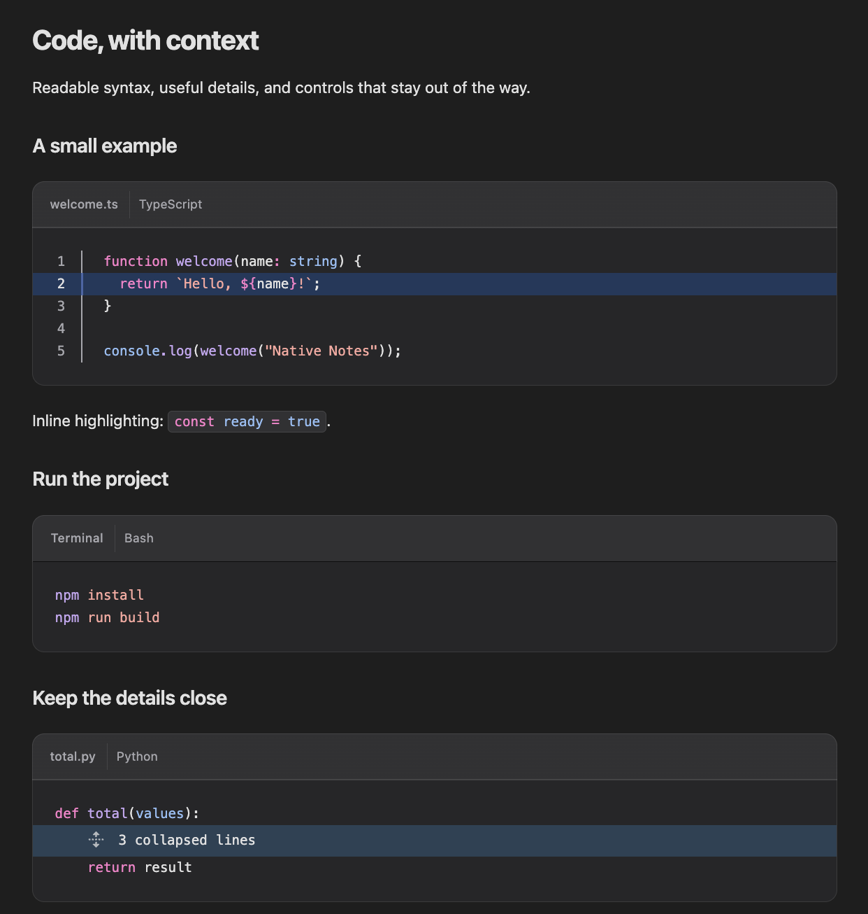

*Native Notes 2.4 on macOS · Built-in code highlighting with public example content.*

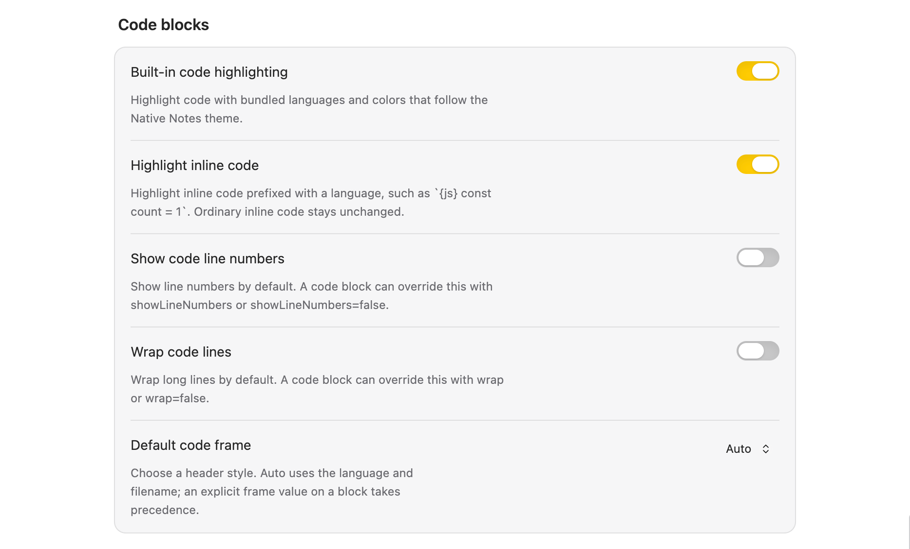

*Native Notes 2.4.4 on macOS · Built-in code preferences.*

| Code blocks setting | Default | What it does |
| --- | --- | --- |
| **Built-in code highlighting** | On | Renders supported code using the bundled highlighter. |
| **Highlight inline code** | On | Highlights inline code with a language prefix, such as `` `{js} const count = 1` ``. |
| **Show code line numbers** | Off | Adds line numbers to rendered code blocks by default. |
| **Wrap code lines** | Off | Wraps long lines in rendered code blocks by default. |
| **Default code frame** | Auto | Chooses Auto, Code, Terminal, or None. Explicit fence metadata takes precedence. |

Turning built-in highlighting off retains these preferences. In Live Preview, click a rendered filename or language to edit it. Keyboard users can focus the header and press **Enter**, **Space**, or **F2**. Press **Enter** or click away to save; press **Escape** to cancel. Each edit changes only the corresponding code-fence value, preserves the viewport, and supports normal undo. Language-only blocks stay language-only. Reading-view headers remain static, and `frame="none"` hides the header.

See the [code highlighting guide](docs/CODE-HIGHLIGHTING.md) for examples, per-block options, inline syntax, and supported languages.

## Build flowcharts visually

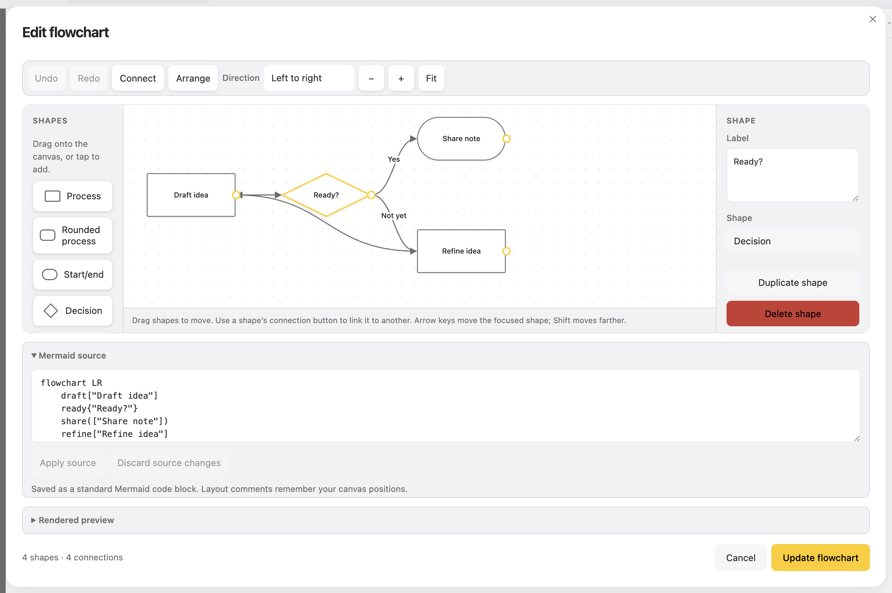

Place the cursor where a flowchart should go, or inside an existing Mermaid flowchart block. Run **Native Notes: Insert or edit flowchart** from the command palette, or choose **Insert or edit flowchart** from the editor context menu. The builder opens inside the current window.

1. Drag a shape from the palette onto the canvas, or click or tap it to add one. Choose from a process rectangle, rounded rectangle, start/end capsule, decision diamond, data parallelogram, database cylinder, subprocess, or circle. Drag nodes to arrange them.
2. Select a node to edit its label and shape. Use **Connect** or the connector beside a node, then choose the destination. Select a connection to edit its label and line style. The inspector also provides deletion controls.
3. Use **Undo**, **Redo**, zoom, **Fit**, and **Arrange** while arranging the chart. Choose its flow direction in the toolbar. Expand **Rendered preview** to see how the saved Mermaid diagram will look in the note.
4. Select **Insert flowchart** or **Update flowchart** to save. **Cancel** leaves the note unchanged. If the source note changes while the builder is open, reopen the builder before applying the draft.

Keyboard users can focus a shape and move it with the arrow keys; hold **Shift** for larger steps. Focus its connection button to link it to another shape. **Delete** removes the selected shape or connection, **Ctrl+Z** / **Cmd+Z** undoes a draft change, and **Ctrl+Enter** / **Cmd+Enter** saves.

The note stores a normal fenced `mermaid` flowchart. **Mermaid source** exposes the draft text; edit it and choose **Apply source** to update the visual canvas, or **Discard source changes** to return to the visual draft. Pending source edits must be applied or discarded before continuing visually or saving.

The builder's manual node positions are retained as Mermaid comments. Mermaid's rendered layout is automatic, so the note preview can arrange the same shapes and connections differently from the canvas. The diagram remains readable by Mermaid without Native Notes.

Existing flowcharts using the supported shapes, labels, and connections can be edited visually. Advanced Mermaid constructs that the builder cannot preserve are rejected with an explanation, leaving the original note intact. Other Mermaid diagram types continue to use ordinary source editing. The builder is available in Live Preview and Source mode; Reading view remains read-only.

On phones and tablets, swipe through the shape palette, tap a shape to add it, then drag it on the canvas. Properties appear below the canvas. The interface follows Obsidian's light or dark appearance. Turn **Settings → Native Notes → Optional features → Visual flowchart builder** off to close the builder and remove its editing commands; saved Mermaid remains in the note.

## Compose and render equations

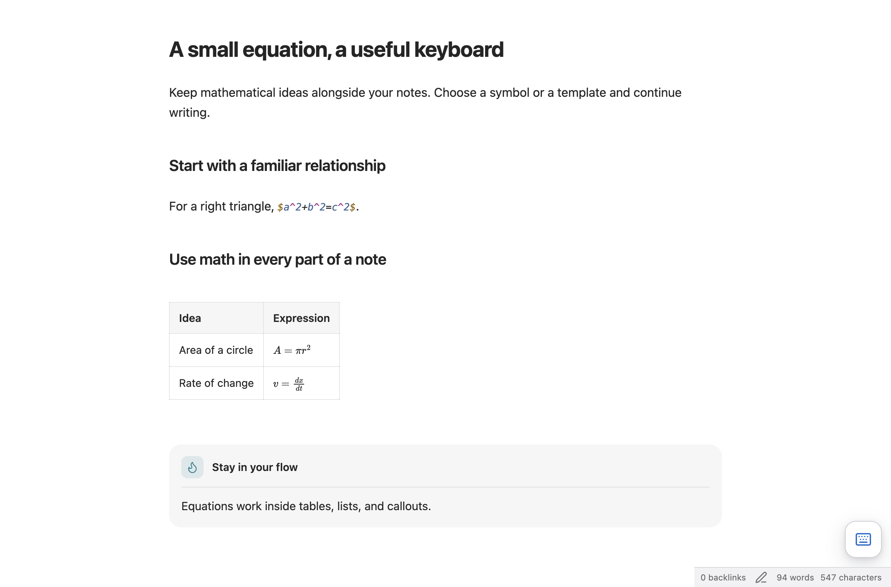

Place the caret inside an inline or display equation to show a floating keyboard button in the bottom-right corner of the editor. Choose any of the four corners in **Settings → Native Notes → Math → Keyboard button position**. The button also works while editing equations in tables, callouts, and lists. In Live Preview, hovering over a rendered equation reveals its keyboard icon so you can open it directly. Click or tap a keyboard button to open the math keyboard; it stays closed until you choose it. On desktop computers and laptops, it opens as a compact overlay beside the equation inside the current window. On phones and tablets, it spans the bottom of the screen.

The 48px floating button uses rounded light and dark surfaces and a larger blue keyboard icon. It leaves clear space above the status bar and follows changes to the bar's height.

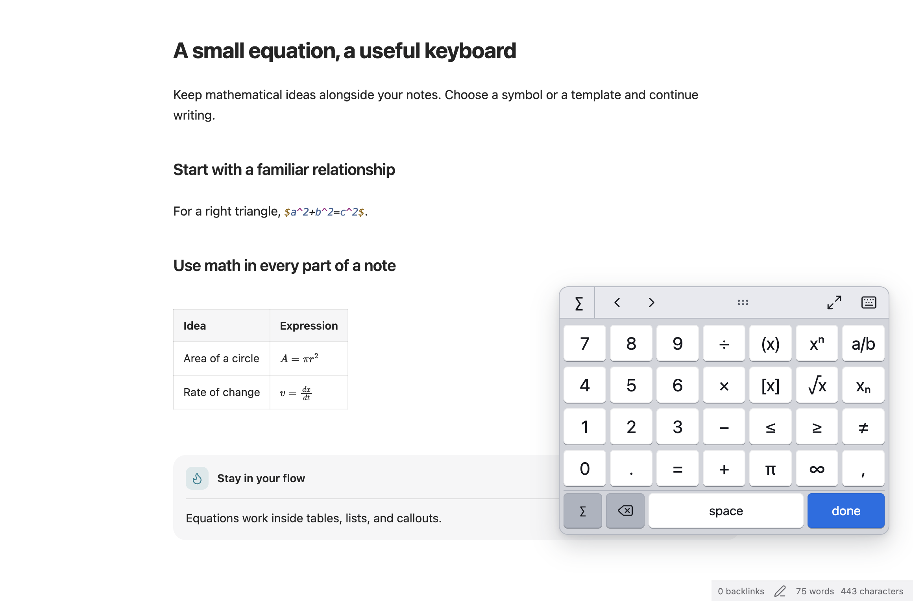

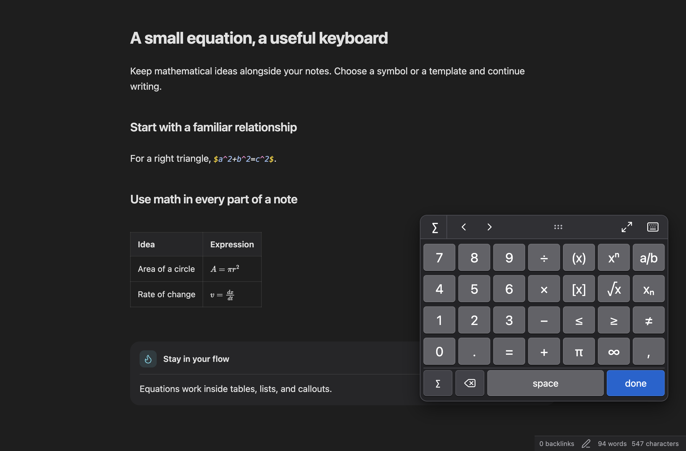

Drag the grip in the desktop keyboard's top toolbar to move it around. It stays within the visible area and keeps a gap around the full equation, adjusting when you scroll or resize. Your chosen position remains until you close the keyboard. You can also focus the grip and use arrow keys to move it, hold Shift for larger steps, or press Home to restore automatic placement.

Enable **Settings → Native Notes → Math → Math keyboard** to show the icon. Type `$` to start an inline equation, or `$$` on its own line for a display equation; the icon is available while editing in Live Preview or Source mode. Reading view stays read-only. Code, comments, escaped dollars, and ambiguous currency such as `$20` do not show a keyboard icon.

The keyboard starts with numbers, fractions, powers, roots, and common operators. Use the bottom **∑** and **123** buttons to switch between templates and the number grid. Tap the top **∑** to choose a math category or search for a symbol. Keys insert LaTeX directly at the note's caret. Template fields let you fill a fraction, matrix, or expression without rewriting its structure; use the field arrows or **Next** to move between them. At the last field, **Done** completes an unfinished equation and moves the caret outside it so it renders. Each insertion supports the note's normal undo. Press **Escape**, click away, move outside math, or close the keyboard to hide it; click or tap the equation's keyboard icon to reopen it.

The keyboard contains **236 keys across 12 categories**, including numbers, Greek symbols, fractions, roots, powers, calculus, linear algebra, statistics, functions, sets, logic, arrows, accents, and chemistry. Its initial math keypad uses four compact rows, with Delete, a wide spacing key, and a blue Next or Done key available in every category. Use your physical keyboard or the full composer to type custom variables. Its appearance follows the app's light or dark theme.

For a larger workspace with a live preview and draft undo/redo, use **Expand** or open the full composer:

1. Place the cursor where an equation should go, select existing LaTeX, or place the cursor inside an equation to edit it. Run **Native Notes: Insert or edit equation** from the command palette, or choose **Insert or edit equation** from the editor context menu.
2. Browse the keyboard categories or search by name, such as **fraction**, **integral**, or **alpha**. Select a template, then replace its highlighted fields. Use **Previous field** and **Next field**, or **Tab** and **Shift+Tab** while fields remain, to move through them. You can also type or paste LaTeX directly.
3. Choose **Inline** or **Display block** and check the preview. **Undo**, **Redo**, delete, and **Clear** affect the equation being composed. Select **Insert equation** or **Update equation**, or press **Ctrl+Enter** / **Cmd+Enter**, to apply it. **Cancel** leaves the note unchanged.

Both interfaces use ordinary `$...$` inline math or `$$...$$` display math. The full composer keeps a separate draft: your note changes only when you insert or update. If the note changes while that dialog is open, reopen it at the intended position. Closing the keyboard keeps the edits already made through its keys.

The keyboard's preview works independently of note rendering. To use the bundled renderer for equations throughout Live Preview and Reading view, enable **Settings → Native Notes → Math → Built-in math rendering**. This separate option is off by default. The keyboard, preview, renderer, and equation fonts work offline.

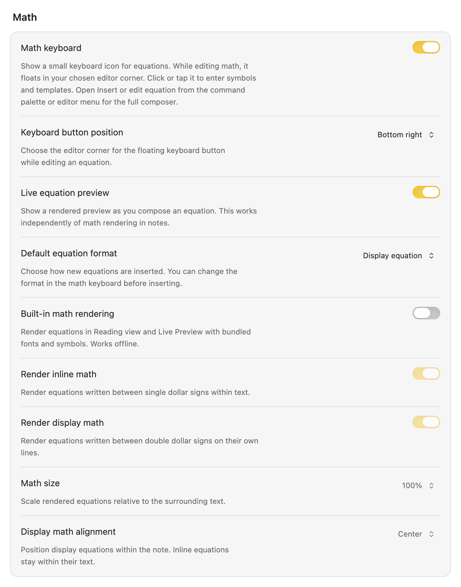

| Math setting | Default | What it does |
| --- | --- | --- |
| **Math keyboard** | On | Shows the equation keyboard icon and enables the keyboard, equation command, and editor context-menu action. |
| **Keyboard button position** | Bottom right | Chooses the editor corner for the floating button while editing an equation. |
| **Live equation preview** | On | Shows a preview while composing. You can also toggle Preview in the keyboard. |
| **Default equation format** | Display equation | Chooses Inline or Display for new equations. Existing equations retain their format when opened. |
| **Built-in math rendering** | Off | Enables the optional equation renderer. |
| **Render inline math** | On | Renders inline equations with compact fractions and limits. |
| **Render display math** | On | Renders standalone equations with full-size fractions and limits. |
| **Math size** | 100% | Choose 80%, 100%, 120%, or 140% of the normal equation size. |
| **Display math alignment** | Center | Aligns display equations left, center, or right. Long equations scroll horizontally. |

Rendering options change presentation only. Turning built-in math rendering off restores the original rendered equations and retains your preferences. Invalid, unsupported, unusually complex equations, HTML/CSS commands, and equations whose complete source is unavailable keep Obsidian's rendering. You can continue using the keyboard with this option off. Turning the keyboard off closes its panel and any equation dialog; an unapplied composer draft is discarded.

## Take your preferences with you

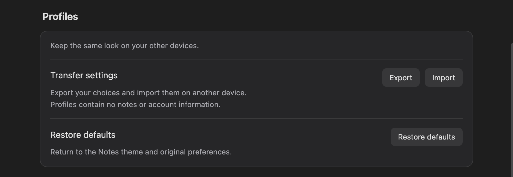

Under **Profiles → Transfer settings**, choose **Export → Copy**. On the receiving device or vault, install Native Notes, choose **Import**, paste the profile, and select **Import** to apply it. **Save file** and **Choose file** provide the same workflow through a JSON file.

Profiles contain only Native Notes appearance, code highlighting, math keyboard and rendering, and editor preferences. They exclude notes and Obsidian's own settings. Import replaces the current Native Notes preferences. **Restore defaults** returns to the Notes preset and the defaults listed above after confirmation; export first if you want to keep your choices.

Older version 1 profiles are accepted and converted to the closest preset and text size. For installation on another device or synchronization of plugin settings, see the [installation guide](docs/INSTALL.md). JSON-file downloads have not been verified on physical iPhone or iPad hardware; copying profile text avoids relying on a download.

Upgrading from 2.2 or earlier? Version 2.3 removes cloud-folder setup and recovery tools. Existing saved history is left untouched, but this version cannot capture, browse, or restore it. See [preserving earlier recovery data](docs/SYNC.md). Your vault's existing sync service continues independently.

## Platform availability

| Platform | Appearance and controls |
| --- | --- |
| macOS | System fonts, native window controls, and optional translucent sidebars through Obsidian's setting. |
| Windows and Linux | Local system fonts, standard window controls, and solid sidebars. |
| iPhone and iPad | Solid surfaces and comfortable controls that do not require hover. |

Built-in code highlighting is included on every supported platform. Preferences can travel through a settings profile or your existing Obsidian settings synchronization.

Native Windows/Linux in-app validation and physical iPhone/iPad validation remain outstanding. Automated platform and responsive-layout fixtures do not replace device testing.

## Privacy and limits

- **No telemetry or plugin network requests.** Fonts and icons are local. Preferences are stored in the vault's plugin configuration.
- **Copy is an intentional clipboard write.** **Profiles → Export → Copy** writes the displayed profile; a code block's **Copy** button writes its code. Both require an explicit click. Native Notes never reads or monitors the clipboard. The Community Plugins directory may report this as a clipboard capability advisory. If access fails, select the text and use your device's copy command.
- **Edits stay in your notes.** Appearance alone does not rewrite Markdown. Code-header edits change the selected fence value; alignment saves a hidden comment. Disabling the plugin does not undo these saved edits.

## Source and distribution

Native Notes development source is maintained in a private repository. The public repository contains the installable JavaScript, styles, version metadata, user guides, and license notices. Obsidian installations and updates continue to use the same public release address. Distributed JavaScript remains inspectable; previously published source and its existing license grants are unaffected.

## Help

[Installation and updates](docs/INSTALL.md) · [Report an issue](https://github.com/PratiyushT/native-notes/issues)

Released under the [MIT license](LICENSE). Native Notes is an independent project and is not affiliated with Apple, Microsoft, or Obsidian.
